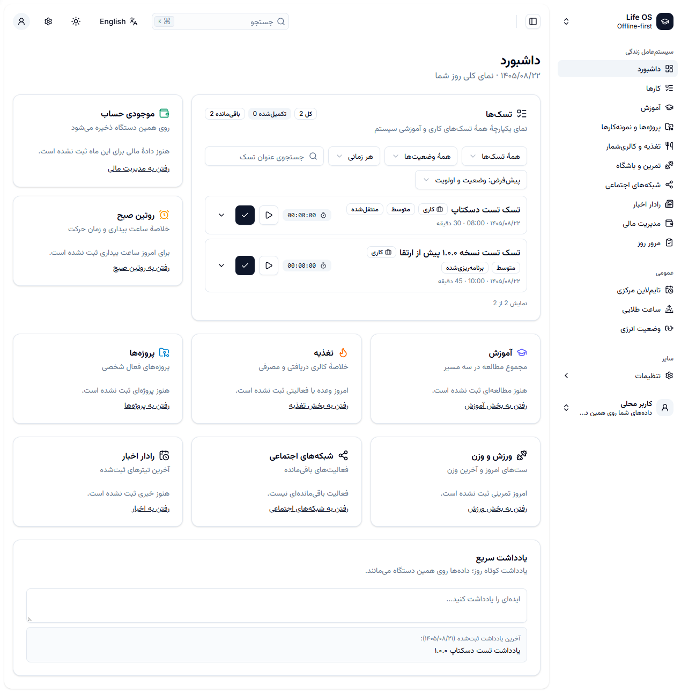
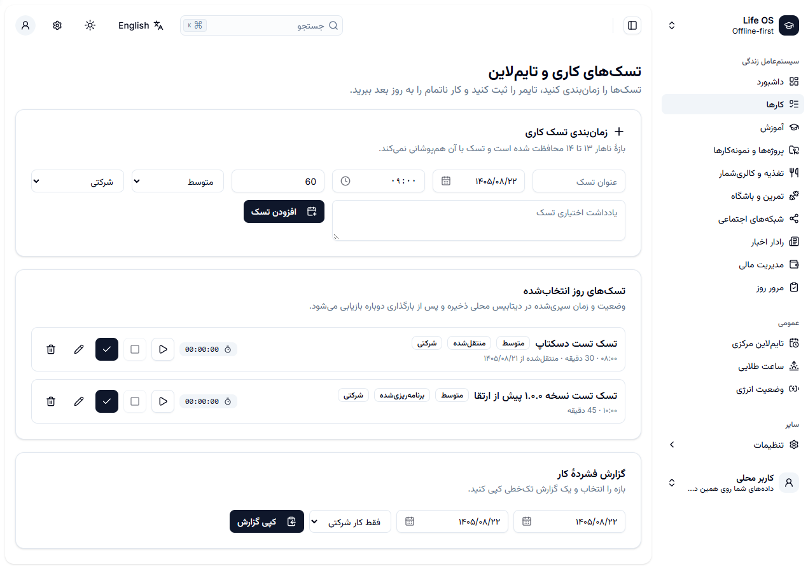

# Mehr Life OS — Windows Desktop

نسخهٔ دسکتاپ Windows برای مدیریت زندگی و کار، با رابط فارسی/انگلیسی، RTL، تاریخ جلالی و ساعت ۲۴ ساعته. رابط React داخل Tauri v2 / WebView2 اجرا می‌شود؛ برای استفاده از فایل نصب، Node.js یا سرور توسعه لازم نیست.

Windows desktop app for personal life and work, with Persian/English, RTL, Jalali dates and 24-hour time. React runs inside Tauri v2 / WebView2. Installed use does not require Node.js or a development server.

**Version: 1.0.7 · Target: Windows x64 (MSVC) · Installer: NSIS, current user**

انتشار نسخهٔ 1.0.7 با تأیید مالک و با اعلام مشکلات شناخته‌شدهٔ زیر انجام می‌شود؛ این تأیید به معنی رفع همهٔ مشکلات نیست. نسخه روی Windows فعلی آزمایش شده است و برای macOS و Linux ساختی انجام نشده است.

Version 1.0.7 publication is owner-authorized with the known limitations below; this authorization does not mean all issues are resolved. Tested on the current Windows machine. No macOS or Linux build has been made.

## تصاویر واقعی / Actual installed-app screenshots

تصاویر زیر از برنامهٔ نصب‌شده و فقط با داده‌های آزمایشی تهیه شده‌اند، نه از mockup یا سرور توسعه.

These screenshots show the installed app with test data, not a mockup or development server.





## امکانات / Modules

- داشبورد و نمایش یکپارچهٔ تسک‌های کاری و آموزشی / Dashboard and unified work/education tasks
- یادداشت روز، تسک‌ها، تایمر و برنامهٔ زمانی / Daily notes, tasks, timers and timeline
- سه مسیر آموزش، دوره‌ها و گزارش‌ها / Three education paths, courses and reports
- پروژه‌ها، تغذیه، تمرین، انرژی و ساعت طلایی / Projects, nutrition, exercise, energy and golden hour
- مدیریت مالی، پیش‌نویس شبکه‌های اجتماعی و مرور روز / Finance, social drafts and daily review
- اخبار دستی و فیدهای عمومی آنلاین / Manual news and online public feeds
- تنظیمات، خروجی JSON و بازگردانی با تأیید / Settings, JSON export and confirmed restore

## نصب و استفاده / Install and use

1. فایل `Mehr Life OS_1.0.7_x64-setup.exe` را اجرا کنید؛ نصب برای کاربر فعلی است.
2. از میانبر **Mehr Life OS** در Desktop یا Start Menu باز کنید.
3. از **تنظیمات → داده‌ها و پشتیبان** خروجی بگیرید و فایل را در محل امن نگه دارید.
4. برنامه را از دکمهٔ بستن پنجره ببندید؛ داده‌ها پس از اجرای مجدد باقی می‌مانند.

Run the installer, then open **Mehr Life OS** from Desktop or Start Menu. Export a JSON backup under **Settings → Data & Backup**, and keep it outside the app's data folder. Close with the window's close button.

### پیش‌نیاز استفاده / Runtime requirements

- Windows x64 و Microsoft Edge WebView2 Runtime / Windows x64 and WebView2 Runtime
- اگر WebView2 نصب نیست، نصب bootstrapper ممکن است به اینترنت نیاز داشته باشد. نصب کاملاً آفلاین روی دستگاه بدون WebView2 آزمایش نشده است.
- WebView2 bootstrap installation may need internet when the runtime is missing. A fully offline install on a machine without WebView2 is not verified.
- فایل نصب فعلاً امضای دیجیتال ناشر ندارد؛ احتمال هشدار SmartScreen وجود دارد. محدودیت امنیتی Windows را برای نصب غیرفعال نکنید.
- The installer is currently unsigned; SmartScreen warnings may occur. Do not disable Windows security protections.

### ارتقا و حذف نصب / Upgrade and uninstall

نسخهٔ 1.0.7 نصب موجود کاربر فعلی را در همان مسیر بهروزرسانی میکند و هیچ گزینه، چکباکس یا صفحهای برای حذف دادههای برنامه نمایش نمیدهد. IndexedDB، WebView2، `%LOCALAPPDATA%\com.mehrlifeos.desktop`، `%APPDATA%\mehr-life-planner` و تمام رکوردها حفظ میشوند. دستیار محلی قدیمی از برنامه حذف شده است، اما فایلهای پیکربندی آن پاک نمیشوند. پیش از نصب، خروجی JSON مستقل بگیرید و در صورت امکان برنامه را ببندید.

Version 1.0.7 updates an existing current-user installation in place and shows no option, checkbox, or page for deleting application data. WebView2/IndexedDB, `%LOCALAPPDATA%\com.mehrlifeos.desktop`, `%APPDATA%\mehr-life-planner`, and all application records are preserved. The legacy local assistant has been removed from the runtime, but its existing configuration files are left untouched. Export an independent JSON backup first and close the app if possible.

**یادآوری:** نسخهٔ 1.0.7 مسیر «حذف نسخهٔ قبلی پیش از نصب» را ندارد و uninstaller را در بهروزرسانی فراخوانی نمیکند.

**Note:** version 1.0.7 has no uninstall-before-install path and does not invoke the uninstaller during an update.

```powershell
Start-Process -FilePath '.\Mehr Life OS_1.0.7_x64-setup.exe' -ArgumentList '/S' -Wait
```

از ارسال مستقیم `/S` در Git Bash خودداری کنید؛ تبدیل مسیر MSYS می‌تواند آن را تغییر دهد و نصب را تعاملی کند.

Avoid passing a bare `/S` from Git Bash: MSYS path conversion can change the argument and cause an interactive install.

## داده‌ها و حریم خصوصی / Data and privacy

دیتابیس `mehr-life-os` از نوع IndexedDB است و نسخهٔ schema فعلی 14 است. دادهٔ نسخهٔ نصب‌شده در این محل نگهداری می‌شود:

```text
%LOCALAPPDATA%\com.mehrlifeos.desktop\EBWebView\Default\IndexedDB\http_tauri.localhost_0.indexeddb.leveldb
```

The installed origin is `http://tauri.localhost`. Development origins such as `http://localhost:1420` have separate IndexedDB data; an empty dev database does not prove that installed data is lost.

- برای کپی فیزیکی پروفایل، ابتدا برنامه و پردازش‌های WebView2 متعلق به آن باید بسته باشند.
- Close the app and its WebView2 processes before making a physical profile backup.
- JSON خروجی رمزنگاری‌شده نیست و می‌تواند دادهٔ شخصی داشته باشد؛ آن را در Git ثبت نکنید.
- Exported JSON is not encrypted and may contain personal information; never commit it to Git.
- بازگردانی JSON داده‌های فعلی را جایگزین می‌کند و نیازمند انتخاب آگاهانه و پشتیبان مستقل است؛ برای تشخیص مشکل داده‌ها از Reset استفاده نکنید.
- JSON restore replaces current records and requires informed confirmation and an independent backup. Do not use Reset for troubleshooting.

## آفلاین و آنلاین / Offline and online

ثبت محلی یادداشت و تسک، مشاهدهٔ صفحات، و داده‌های IndexedDB بدون اینترنت کار می‌کنند. در آزمون شبکهٔ مسدودشده، ۱۹ صفحهٔ اصلی باز شد، یادداشت و تسک پس از Restart باقی ماند و هیچ درخواست خارجی خودکار در این صفحات ثبت نشد. این به معنی آزمایش تمام عملیات همهٔ ماژول‌ها نیست.

Local notes/tasks, page rendering and IndexedDB persistence work offline. With external networking blocked, 19 primary pages rendered, a note/task survived restart, and no automatic external request was observed on those pages. Not every workflow in every module has been exercised offline.

- دریافت خبر جدید و فید RSS به شبکه و محدودیت‌های CORS منبع وابسته است؛ مسیر جایگزین ممکن است از سرویس `rss2json` استفاده کند.
- New news/RSS fetches require network access and depend on source CORS policy; fallback may use the external `rss2json` service.
- AI آنلاین فقط با endpoint سرور در `VITE_AGENT_API_URL` فعال می‌شود؛ در build آزمایش‌شده تنظیم نشده بود. موفقیت سرویس AI واقعی آزمایش نشده است.
- Remote AI requires a server endpoint in `VITE_AGENT_API_URL`; none was configured in the tested build. Real remote-AI success is untested.
- هیچ کلید خصوصی یا API secret را در متغیر `VITE_*` قرار ندهید؛ این متغیرها در frontend قابل مشاهده‌اند.
- Never put private/API secrets in `VITE_*` variables; they are exposed to the frontend.
- پیش‌نویس شبکهٔ اجتماعی خودکار منتشر نمی‌شود؛ درخواست آنلاین AI، در صورت تنظیم، متن prompt را به endpoint می‌فرستد.
- Social drafts are not auto-published. A configured AI call sends the prompt to its endpoint.

## توسعه و Build فقط Windows / Windows-only development and build

پیش‌نیاز ساخت: Node.js، Rust stable با target `x86_64-pc-windows-msvc`، Microsoft Visual Studio Build Tools با C++ و Windows SDK، و WebView2. نسخهٔ آزمودهٔ ابزارها: Node.js 24.22.1 و Rust/Cargo 1.99.1.

Build prerequisites: Node.js, Rust stable for `x86_64-pc-windows-msvc`, official Microsoft C++ Build Tools/Windows SDK, and WebView2. Tested tools: Node.js 24.22.1, Rust/Cargo 1.99.1.

مدیریت بستهٔ پروژه npm است و `package-lock.json` تنها lockfile معتبر میباشد. CI با `npm ci` و Node.js 24.22.1 وابستگیها را بهصورت قابلتکرار نصب میکند. نصب تمیز وابستگیها با موفقیت آزمایش شده است.

npm is the package manager and `package-lock.json` is the only authoritative lockfile. CI installs dependencies reproducibly with `npm ci` on Node.js 24.22.1; a clean install was verified in an isolated directory.

```sh
npm run dev
npm run desktop:dev
npm run check:i18n
npm run type-check
npm run lint
npm test
npm run build
cargo check --locked --manifest-path src-tauri/Cargo.toml
npm run desktop:build -- --target x86_64-pc-windows-msvc --bundles nsis
```

```text
src-tauri/target/x86_64-pc-windows-msvc/release/bundle/nsis/Mehr Life OS_1.0.7_x64-setup.exe
```

## مشکلات شناخته‌شده و انتشار / Known limitations and publication

- `target=_blank` / `window.open` در آزمون نصب‌شده پنجرهٔ تازه‌ای باز نکرد؛ بازکردن لینک‌های خارجی دوره و خبر هنوز باید اصلاح و آزمایش شود.
- External new-window links did not open in the installed probe. Course/news external links need a targeted fix and real test.
- lint: صفر خطا و ۳ هشدار؛ build: هشدار chunk بزرگ و هشدار محیط Vite.
- Lint: zero errors, three warnings; build: large-chunk and Vite environment warnings.
- ممیزی npm در حال حاضر ۰ بحرانی، ۰ بالا، ۱۰ متوسط و ۰ پایین گزارش میدهد؛ همگی مربوط به ابزارهای توسعه (minimatch در زنجیره ESLint و پلاگین مرتبسازی Prettier) هستند، نه کد ارسالشده به کاربر.
- npm audit currently reports 0 critical, 0 high, 10 moderate and 0 low; all are dev-tooling only (minimatch via ESLint and the Prettier import-sort plugin), not shipped application code.
- فید خصوصی یا URL دارای رمز/token وارد نکنید؛ شکست درخواست مستقیم می‌تواند تمام URL را به سرویس واسط rss2json بفرستد. پاسخ فید محدودیت اندازهٔ صریح ندارد.
- Do not enter private or credential/token-bearing feed URLs: a failed direct request can send the complete URL to rss2json. Feed response size is not explicitly capped.
- اعتبارسنجی backup ساختار، store و کلیدها را بررسی می‌کند، نه schema کامل تمام فیلدها؛ فقط backup مورداعتماد خود را وارد کنید. XSS از این مسیر اثبات نشده است.
- Backup validation checks structure, stores and keys, not every record-field schema. Import only your own trusted backups. XSS through this path is not demonstrated.
- پوشش کامل همهٔ نسخه‌های Windows، دستگاه بدون WebView2 و AI واقعی هنوز تأیید نشده است.
- Full Windows-version coverage, missing-WebView2 installation and real AI are not verified.
- نام فایل backup از تاریخ UTC ساخته می‌شود و نزدیک نیمه‌شب ممکن است با تاریخ محلی تفاوت داشته باشد.
- Backup filenames use UTC dates and can differ from the local date near midnight.
- مشکل قبلی دوره‌ها در پروفایل واقعی گزارش‌شدهٔ کاربر هنوز BLOCKED است؛ تست این پروفایل دسکتاپ، تأیید رفع آن مشکل نیست.
- The previously reported education-course issue in the user's separate real profile remains BLOCKED; this desktop profile does not verify that fix.

مخزن مقصد با تأیید مالک: [abolfazlkianejad/mehr-life-time](https://github.com/abolfazlkianejad/mehr-life-time). نسخه‌های نصب Windows در [GitHub Releases](https://github.com/abolfazlkianejad/mehr-life-time/releases) ارائه می‌شوند، نه در تاریخچهٔ سورس. داده‌های شخصی، دیتابیس‌ها، backupها، فایل‌های موقت و کلیدها نباید وارد Git شوند. Remote قالب اصلی با نام `upstream` حفظ شده است.

Owner-approved repository: [abolfazlkianejad/mehr-life-time](https://github.com/abolfazlkianejad/mehr-life-time). Windows installers belong in [GitHub Releases](https://github.com/abolfazlkianejad/mehr-life-time/releases), not source history. Personal data, databases, backups, temporary files and credentials must stay out of Git. The original template remote is retained as `upstream`.

فایل‌های نمونهٔ Chats، مسیر موقت Help Center و تصویر قالب قبلی بدون تغییر محتوا در `template-archive/shadcn-admin/` حفظ شده‌اند؛ این آرشیو جزو برنامهٔ نصب‌شده نیست و مسیرهای آزمایش‌شدهٔ Mehr Life OS را تغییر نمی‌دهد.

The original sample Chats files, placeholder Help Center route and template screenshot are preserved byte-for-byte in `template-archive/shadcn-admin/`. This source archive is not part of the installed app and does not change the tested Mehr Life OS routes.

## انتساب و مجوز / Attribution and license

رابط بر پایهٔ Shadcn Admin اثر Sat Naing و اجزای Shadcn UI / Radix UI ساخته شده است. فایل `LICENSE` موجود، متن MIT و حق‌نشر قالب اصلی را حفظ می‌کند؛ برای Mehr Life OS هیچ مجوز نهایی تازه‌ای انتخاب یا ادعای مالکیتی تغییر داده نشده است.

The UI derives from Shadcn Admin by Sat Naing and Shadcn UI / Radix UI components. The existing `LICENSE` preserves the upstream MIT copyright notice. No new final license or ownership claim has been selected for Mehr Life OS.

**پیشنهاد برای تصمیم مالک:** در صورت انتشار متن‌باز، MIT گزینهٔ ساده‌ای است؛ تصمیم نهایی، بررسی حقوق اجزای ثالث و مجوز نام/دارایی‌ها نیازمند تأیید است. این پیشنهاد، انتخاب مجوز محسوب نمی‌شود.

**Owner decision proposal:** MIT is a simple option for an open-source release, subject to owner approval and third-party/asset rights review. This proposal does not select a license.

---

## پروژهٔ موجود تلگرام / Existing Telegram project

پروژهٔ Python/Telegram موجود، تمام فایل‌ها، تست‌ها و تاریخچهٔ آن حفظ شده‌اند. نسخهٔ نصب Windows مستقل از این backend اجرا می‌شود؛ ارتباط خودکار یا یکپارچه‌سازی بین این دو پیاده‌سازی ادعا نمی‌شود. راهنمای قبلی آن بدون حذف محتوا در ادامه آمده است.

The existing Python/Telegram project, its files, tests and history are preserved. The Windows installer runs independently of this backend; no automatic integration between the two implementations is claimed. Its original documentation is retained below.

# Mehr Life Time

دستیار برنامه‌ریزی شخصی در تلگرام با سوپرگروه خصوصی و تاپیک برای هر حوزهٔ زندگی. بات از مدیر دسترسی می‌گیرد، رضایت استفاده از AI را ثبت می‌کند، سپس فضای تلگرامی هر کاربر را آماده می‌سازد.

## قابلیت‌های برنامه‌ریزی

- معارفهٔ تطبیقی با حدود ۲۰ سؤال و سقف ۳۰ سؤال؛ حوزه‌ها، تعهدهای ثابت، اولویت‌ها، خواب، زمان آزاد و محدودیت‌ها در حافظهٔ شخصی نگه‌داری می‌شوند.
- ساخت تاپیک جدا برای هر حوزه و تاپیک جدا برای پروژه‌های بزرگ.
- دریافت هدف یا پروژه با پیام طبیعی، دکمه یا فایل متنی، PDF و Word. AI تا روشن‌شدن محدوده، کارهای باقی‌مانده و برآورد زمان، برنامه نمی‌سازد.
- شکستن هدف به تسک، چیدن آن‌ها در بازه‌های آزاد، انتشار برنامه در تاپیک حوزه و هشدار دربارهٔ گام‌هایی که تا موعد جا نمی‌شوند.
- برنامهٔ هفتگی از شنبه ساعت ۰۶:۰۰ و برنامهٔ روزانه هر روز ساعت ۰۶:۰۰ به وقت تهران.
- دکمه‌های شروع و اتمام، ثبت زمان واقعی و تطبیق تدریجی برآورد مدت با لاگ‌های شخصی.
- پیگیری در موعد پایان و حداکثر سه یادآوری با فاصلهٔ ۱۵ دقیقه؛ تسک ناتمام باز می‌ماند و به بازهٔ آزاد بعد منتقل می‌شود.
- کیبورد ثابت برای افزودن هدف، برنامهٔ هفتگی، شروع/اتمام، پیشرفت و حوزه‌ها.

پیام‌ها و فایل‌های کاربر فقط به نمونهٔ Ollama روی همین دستگاه/سرور (`localhost` یا `127.0.0.1`) فرستاده می‌شوند. جست‌وجوی وب برای محتوای کاربر در این نسخه غیرفعال است تا مقصد و دادهٔ ارسالی با رضایت مشخص کاربر تأیید شود.

## پیش‌نیازها

- Python 3.11 یا بالاتر
- توکن بات تلگرام
- Ollama محلی و یک مدل چت، مانند مدل تنظیم‌شده در `.env`
- حساب کاربری اختصاصی تلگرام برای ساخت سوپرگروه‌های کاربران
- `api_id` و `api_hash` از `my.telegram.org`

حساب اختصاصی سامانه سازنده و مالک گروه‌ها می‌ماند و در گروه‌ها حضور دارد. این موضوع در صفحهٔ رضایت کاربر اعلام می‌شود.

## راه‌اندازی

```powershell
python -m venv .venv
.\.venv\Scripts\Activate.ps1
python -m pip install --upgrade pip
pip install -r requirements.txt
Copy-Item .env.example .env
```

مقادیر `TELEGRAM_BOT_TOKEN`، `TELEGRAM_ALLOWED_USER_IDS` یا `TELEGRAM_ADMIN_CHAT_ID` و اطلاعات API حساب اختصاصی را در `.env` تنظیم کنید. مدل پیش‌فرض فقط به Ollama محلی متصل می‌شود.

برای ساخت کلید رمزگذاری نشست:

```powershell
python -c "from cryptography.fernet import Fernet; print(Fernet.generate_key().decode())"
```

کلید را در `TELEGRAM_SESSION_ENCRYPTION_KEY` بگذارید. سپس از ترمینال محلی، ورود حساب اختصاصی را یک‌بار انجام دهید:

```powershell
python scripts/authorize_telegram_account.py
```

کد ورود و رمز دومرحله‌ای فقط در همان ترمینال وارد می‌شود. فایل نشست رمزگذاری‌شده در مسیر `TELEGRAM_USER_SESSION` ذخیره می‌شود؛ فایل نشست و کلید را در مخزن Git قرار ندهید.

در Telegram BotFather، بات را طوری تنظیم کنید که بتواند به گروه‌ها اضافه شود. ساخت گروه/تاپیک و عضویت مستقیم کاربر به سیاست‌های تلگرام و دسترسی حساب اختصاصی بستگی دارد. اگر تلگرام افزودن مستقیم کاربر را نپذیرد، لینک دعوت برای او فرستاده می‌شود؛ اگر افزودن بات هم رد شود، کاربر باید آن را به گروه اضافه کند.

## اجرا

```powershell
python -m app.main
```

API سلامت اختیاری:

```powershell
uvicorn app.api:app --host 127.0.0.1 --port 8000
```

پایگاه‌دادهٔ پیش‌فرض در `data/mehr_life_time.db` ساخته می‌شود. بات و API را هر دو با دسترسی شبکهٔ محدود اجرا کنید.
